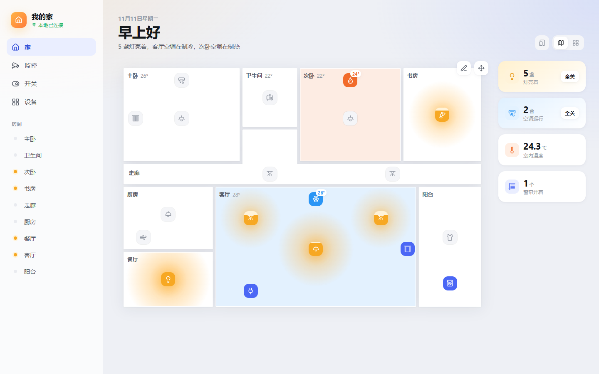
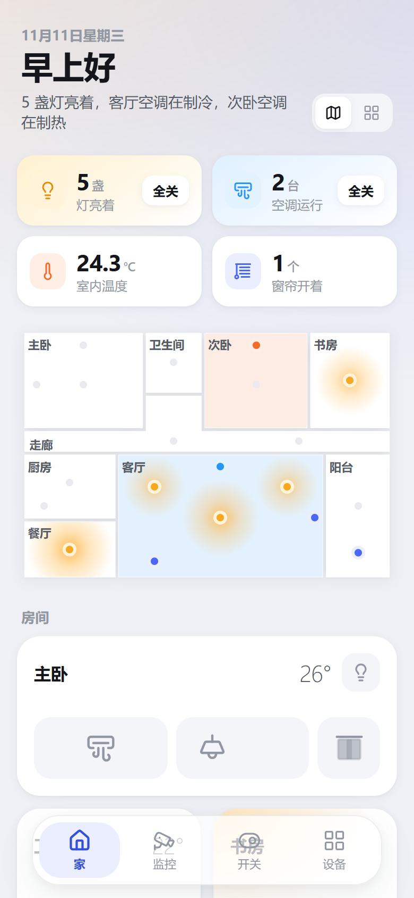
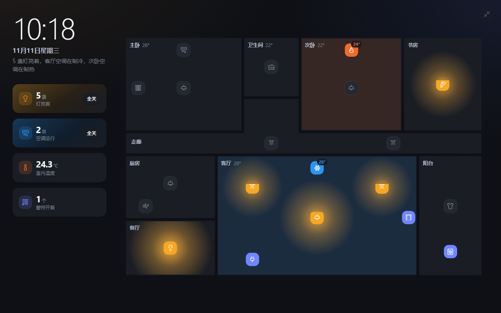
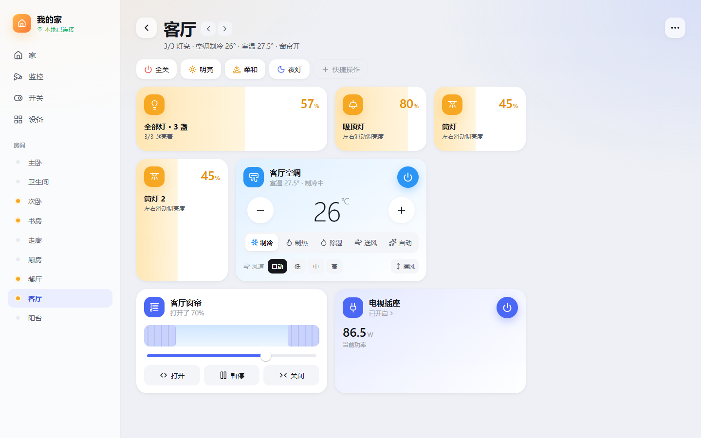
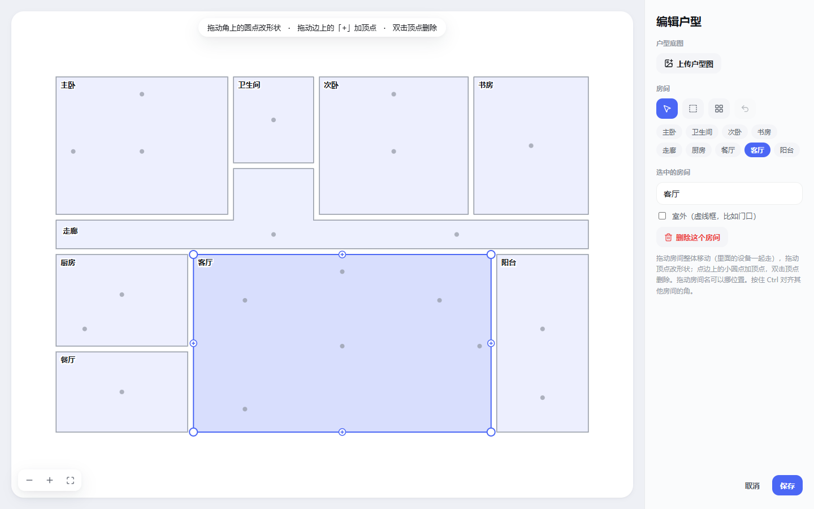
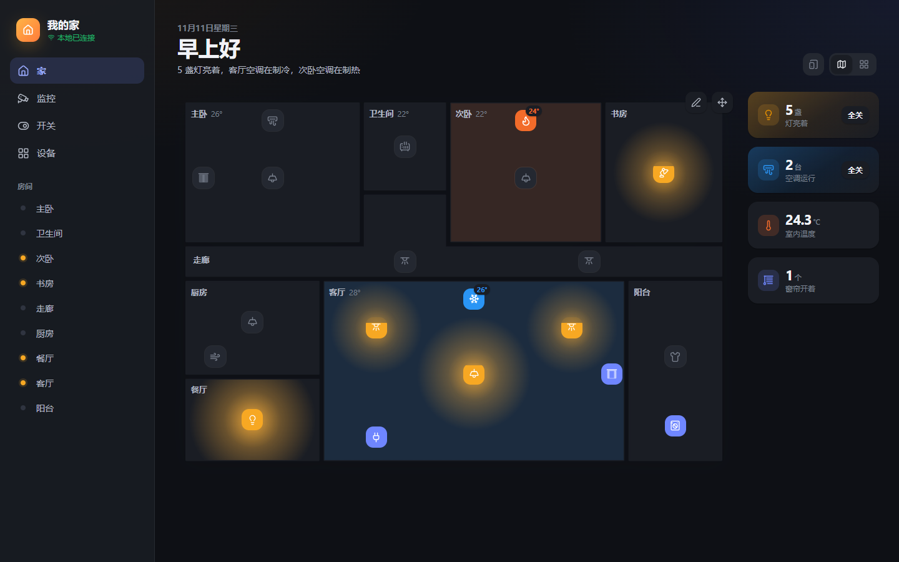

# mi-local

米家设备的本地控制中心。装在家里的 NAS、软路由或小主机上，用手机、平板、电脑的浏览器打开就能用。断网时，局域网里的设备和无线开关照常工作。



## 它能做什么

**在户型图上看到并控制整个家**
- 首页就是你家的户型图：亮着的灯在地面上画出暖光，开着空调的房间染上冷暖色，窗帘、插座、空调都有直观的状态。
- 单击图标直接开关，长按或右键打开详细控制。
- 户型图可以描着户型图片画，也可以一键自动布局；设备位置拖一拖就好。

**手机、平板、墙面屏都好用**
- 手机上是户型缩略图加房间卡片，点房间进入完整控制；可以「添加到主屏幕」当 App 用。
- 平板可以全屏挂在墙上：大时钟、常亮、户型图上直接控制。

<p>
  
  
</p>

**接入米家设备，本地优先**
- 登录米家账号后，自动导入设备、房间和局域网密钥。
- 灯、空调、窗帘、插座按 MIoT 规格自动识别，用上专门的控制卡片；其他设备列出全部属性，可以直接调节。
- 能在局域网控制的设备优先走局域网，速度快，断网也能用；不行再自动改走云端。
- 万能遥控里的红外设备（空调、电视、风扇）显示成一块按键面板。

<p>
  
  
</p>

**还有这些**
- **无线开关**：小米网关 2 下的无线开关，可以绑定单击、双击、长按要控制的设备，全程在局域网内完成，断网照常。
- **摄像头**：通过 [go2rtc](https://github.com/AlexxIT/go2rtc) 在本地看小米摄像头的实时画面，有全屏监控墙，也能回看米家的看家录像。
- **统计和记录**：开关按键、开门记录永久保存，可以按天、按小时查看，还有设备使用时长排行。
- **安全**：每台浏览器都要先配对才能用。权限分管理员、家人、墙面面板三种，随时可以撤销。
- **小爱音箱桥接**（可选）：对小爱说米家里没有的设备（比如美的空调），由本机执行并通过音箱回答。

<details>
<summary>深色模式</summary>



</details>

## 使用条件

| 需要 | 说明 |
|---|---|
| 一台常开的 Linux 设备 | NAS、软路由、树莓派、小主机都可以。arm64 或 amd64，装好 Docker 和 Docker Compose |
| 和米家设备在同一局域网 | 小米网关 2 的按键事件是组播，还必须和本机在同一网段 |
| 米家账号 | 支持中国大陆、新加坡、欧洲、美国、俄罗斯、印度服务器。看家录像和小爱音箱桥接目前只支持中国大陆 |
| 能访问 ghcr.io 拉镜像 | 国内慢的话，可以用南大镜像 `ghcr.nju.edu.cn`（见下文） |
| 可选：小米网关 2（`lumi.gateway.v3`） | 想让无线开关、Zigbee 窗帘和插座在断网时也能用，就需要它 |
| 可选：小米摄像头 | 在本地看实时画面，部署模板里已经带上 go2rtc |

## 部署

### 一键部署

在那台 Linux 设备上执行：

```bash
curl -fsSL https://raw.githubusercontent.com/cnwinds/mi-local/main/deploy/install.sh | sh
```

它会在 `~/mi-local` 下准备好 `docker-compose.yml` 和 go2rtc 的安全配置（只监听本机），然后启动 mi-local 和 go2rtc，最后打印访问地址。

- 拉镜像慢：在命令前面加上 `MI_LOCAL_MIRROR=ghcr.nju.edu.cn`，即 `curl … | MI_LOCAL_MIRROR=ghcr.nju.edu.cn sh`。
- 换安装目录：加上 `MI_LOCAL_DIR=/你的/目录`。
- 升级：`cd ~/mi-local && docker compose pull && docker compose up -d`。

### 让 AI 帮你部署

如果你在用 Cursor、Claude Code、Codex 这类能执行命令的 AI 助手，并且它能通过 SSH 登录那台设备，可以把下面这段话发给它：

```text
请帮我把 mi-local（https://github.com/cnwinds/mi-local）部署到 <用户>@<设备 IP> 上：
1. SSH 登录，确认装有 Docker 和 Docker Compose（没有的话按官方文档安装）。
2. 执行仓库里的一键部署脚本 deploy/install.sh；拉镜像很慢时，设置 MI_LOCAL_MIRROR=ghcr.nju.edu.cn 后重试。
3. 确认 mi-local 在 8080 端口能访问，go2rtc 只监听 127.0.0.1（1984、8554、8555 端口不能对局域网开放）。
4. 把访问地址告诉我。不要读取或输出日志里的配对码，也不要读取 data 目录里的密钥和登录信息。
```

### 手动部署

```bash
mkdir -p ~/mi-local/go2rtc && cd ~/mi-local
curl -fsSLO https://raw.githubusercontent.com/cnwinds/mi-local/main/docker-compose.yml
# go2rtc 的配置必须在第一次启动前放好，否则它会在所有网卡上开放没有密码的管理页
curl -fsSL -o go2rtc/go2rtc.yaml https://raw.githubusercontent.com/cnwinds/mi-local/main/deploy/go2rtc.yaml
docker compose up -d
```

- **网络模式**：mi-local 必须用 `network_mode: host`，否则收不到网关的组播。
- **不需要摄像头**：可以删掉 compose 里的 `go2rtc` 服务。

### 先看看演示

不想马上接入自己的设备，可以先跑一个演示：内置一套虚构的三室户型和模拟设备，开关、调光、空调都能点。

```bash
docker run --rm -p 8080:8080 -e HUB_DEMO=1 ghcr.io/cnwinds/mi-local:latest
```

打开 `http://<本机 IP>:8080`，点「开始使用」即可。关掉容器后，演示数据也随之消失。

## 首次使用

1. **成为管理员**：浏览器打开 `http://<本机 IP>:8080`，看到「欢迎使用」后点「开始使用」。
   - 这一步只在程序启动后 1 小时内、而且还没有任何设备配对时有效，防止被别人抢先认领。
   - 错过了时间：用日志里的一次性配对码配对，执行 `docker logs mi-local 2>&1 | grep 一次性配对码` 查看。
   - 被别人抢先认领了，或者管理员设备都丢了：执行 `docker exec mi-local python -m homehub.auth` 生成新的配对码，自己配对后把不认识的设备撤销掉。
2. **登录米家**：首页的「开始使用」卡片里，选好米家 App 设置的服务器地区，点「扫码登录」，用米家 App 扫码。登录后会自动同步设备和房间。
3. **户型图**（在电脑上操作）：首页标题栏点「创建户型图」，上传户型图片后用「画房间」沿墙内侧描出每个房间，或者直接点「自动布局」。保存后，用「调整设备位置」把设备拖到实际位置，按住 Ctrl 可以对齐。
4. **小米网关 2**（如果有）：在「设备」页的网关里点「自动从网关获取密钥」。mi-local 会用同步来的通信 token 直接从网关读取局域网密钥；网关还没有密钥时，经你确认后生成一个写入。
5. **摄像头**（如果有）：打开「监控」页，在「连接摄像头」卡片里，用和米家相同的账号登录一次，按提示输入验证码即可。密码只转发给本机的 go2rtc 用这一次，mi-local 不保存。
6. **给家人的设备配对**：在「设备」页的「已授权设备」里点「配对新设备」，先选角色，再用手机扫码，或者在平板上输入 6 位配对码。
   - **管理员**：全部功能。
   - **家人**：控制设备、看摄像头和记录，不能改设置。
   - **墙面面板**：只能控制设备。首页标题栏的平板图标可以进入全屏墙面模式。

## 设备支持和断网能力

| 设备 | 断网时 |
|---|---|
| 支持局域网 MIoT 协议的 Wi-Fi 设备（大部分新款） | 可以控制 |
| Yeelight 吸顶灯、飞利浦灯 | 可以控制 |
| 小米网关 2 下的无线开关、插座、窗帘，以及开关联动规则 | 可以控制 |
| 老款 Wi-Fi 设备（局域网不懂 MIoT）、蓝牙 Mesh、多模网关子设备、红外遥控 | 只能走云端，断网不可用 |
| 摄像头实时画面 | 取决于摄像头的 P2P 协议，同一局域网内通常可用 |
| 米家同步、看家录像、小爱音箱桥接 | 需要联网 |

- **自动识别**：灯、空调、窗帘、插座，只要型号带 [MIoT 规格](https://home.miot-spec.com/)就能识别。其他带规格的设备（油烟机、净水器、洗衣机、传感器……）会列出全部属性，可以查看和调节。
- **专门适配的型号**：Yeelight 吸顶灯、飞利浦筒灯、小米网关 2 及其子设备、米家互联网空调 C1、空调伴侣、云米浴霸、晾霸晾衣架。
- **可选接入**：美的空调（局域网协议）、鹿客门锁（只读）。
- **在线状态**：走云端的设备以米家报告的在线状态为准，离线设备不会显示成在线。

## 安全

- **设备配对**：每个浏览器配对一次后，拿到一个长期有效的 token，存在 HttpOnly、SameSite=Strict 的 cookie 里。本机只保存 token 的哈希，可以随时撤销，被撤销设备的实时连接会立刻断开。
- **首次认领**：只在启动后 1 小时内、而且一台设备都没配对时有效。装好后请尽快自己打开认领。
- **防试错**：配对码输错会累计，有效的码累计错 5 次就作废；同一个 IP 10 分钟内错 10 次会被暂时挡住。
- **防跨站请求**：写操作和 WebSocket 都会检查 Origin，挡住来自其他网站的请求。
- **go2rtc**：只监听 `127.0.0.1`。mi-local 只转发播放请求，以及管理员的小米登录这一个接口。
- **已知限制**：目前是 HTTP 明文传输。建议访客连路由器的访客网络；从外网访问时用 Tailscale 之类的 VPN，不要把端口直接映射到公网。

## 数据和备份

所有数据都在安装目录的 `data/` 下，备份时整个打包即可。里面有设备 token、米家登录状态、户型图等隐私数据，**不要放到公开位置**。

| 文件 | 内容 |
|---|---|
| `devices.json` | 设备列表（含局域网 token） |
| `rules.json`、`scenes.json`、`panels.json` | 开关绑定、快捷场景、房间面板布局 |
| `floorplan.json`、`floorplan-bg` | 户型图和上传的户型底图 |
| `cloud.json` | 米家登录状态 |
| `auth.json` | 已配对的设备（只存 token 的哈希） |
| `events.db` | 永久保存的事件和统计 |

## 本地开发

```bash
python -m venv .venv
.venv/bin/pip install -r backend/requirements.txt pytest
.venv/bin/pip install --no-deps python-miio==0.5.12
cd backend && ../.venv/bin/python -m pytest -q        # 后端测试
cd backend && HUB_DEMO=1 HUB_DATA=/tmp/mi-demo ../.venv/bin/python -m homehub   # 演示数据，http://localhost:8080

cd frontend && npm install && npm run dev             # 前端开发服务器，接口代理到 127.0.0.1:8080（API_TARGET 可改）
```

国内构建镜像可以切换软件源：

```bash
docker build --build-arg NPM_REGISTRY=https://registry.npmmirror.com \
             --build-arg PIP_INDEX_URL=https://pypi.tuna.tsinghua.edu.cn/simple -t mi-local .
```

## 许可证

[MIT](LICENSE)。米家登录协议参考了 [Xiaomi-cloud-tokens-extractor](https://github.com/PiotrMachowski/Xiaomi-cloud-tokens-extractor)（MIT），摄像头取流依赖 [go2rtc](https://github.com/AlexxIT/go2rtc)（MIT）。
